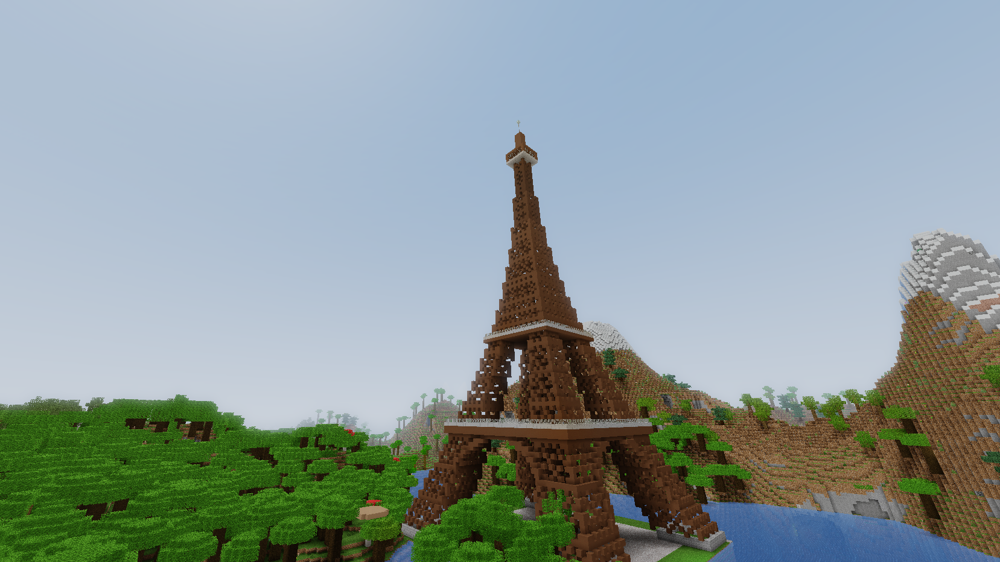

<p align="center">
  
</p>

<h3 align="center">A native voxel sandbox for Mac, iPad, and iPhone, with powerful creative building tools.</h3>

<p align="center">
  <em>Free and open source, built from scratch in Swift + Metal.<br>
  Survive alone, or build together over LAN with a creative toolkit.<br>
  Every sound synthesized in real time. Every chunk carved from noise.</em>
</p>

<p align="center">
  
  
</p>

---

> ### New in Pebble 1.4: iPad and iPhone (beta)
> The same game and worlds on iPad and iPhone (landscape), and they play LAN games with the Mac. Touch controls, hardware keyboard and mouse, and game controllers all work. Also new everywhere: a **headlamp**, and four **world wonders** for `/place` (Eiffel Tower, Stonehenge, Colosseum, Devils Tower). See [Install](#install) and the [1.4.0 notes](CHANGELOG.md#140--2026-10-12--ipad--iphone-headlamp-world-wonders).

**Pebble** is a native voxel sandbox with the full overworld/nether/end progression: worldgen, mobs, sparkstone, crafting, enchanting, brewing, villages, raids and boss fights, plus a creative building toolkit and LAN multiplayer. It is **~55,000 lines of Swift** with **no external dependencies** and no game engine: a hand-written Metal renderer, an audio engine that synthesizes every sound at runtime, and multiplayer on Apple's Network framework. Its textures are the built-in [Faithful 32x](https://faithfulpack.net) pack.

Pebble is an original fan re-creation inspired by Minecraft: Java Edition 1.20. It is **not affiliated with, endorsed by, or connected to Mojang Studios or Microsoft**, and contains no Mojang code or assets. See the [Disclaimer](#disclaimer).

> **Pebble 1.5 is a beta.** The engine is covered by 790 regression checks, but a game this size has bugs we haven't found yet, and the iOS app and multiplayer are the least battle-tested parts. If you hit one, please [open an issue](https://github.com/nullrouten0/pebble/issues) — or better, send a fix. See [Reporting bugs & contributing](#reporting-bugs--contributing).

## By the numbers

| | |
|---|---|
| Lines of Swift | ~56,600 across 109 files |
| External dependencies | **0** (Apple frameworks only) |
| Blocks | 879 |
| Items | 1,207 |
| Biomes | 63 (overworld, nether, end, cave biomes) |
| Entity types | 110 (65+ mobs with full AI, including 10 anime-style animals; vehicles, projectiles) |
| Structures | 19 worldgen types (villages, strongholds, bastions, end cities, ancient cities…), plus 18 placeable builds |
| Multiplayer | LAN: one host, any number of guests, found automatically (Bonjour) |
| Regression checks | 817, all green (`pebble test`) |
| Textures | [Faithful 32x](https://faithfulpack.net) by Faithful (third-party, fully credited) |
| Audio assets | 0 — fully synthesized |
| Performance | 200+ fps at full fancy settings on an Apple-silicon MacBook Air with Max FPS set to Unlimited (the default cap is 120) |

## Features

- **Full survival loop** — mining with tool tiers, hunger/saturation, XP, sleeping, fall damage, drowning, fire, status effects, death messages, respawn/keep-inventory game rules.
- **Worldgen** — multi-noise climate sampling through spline-driven terrain, 3D density caves (cheese/spaghetti/noodle), ravines, aquifers, layered ore distribution, and 63 biomes including lush caves, dripstone caves and the deep dark.
- **Three dimensions** — overworld, nether (fortresses, bastions, all five nether biomes) and the end (dragon fight, end cities, gateways), connected by working portals.
- **Structures** — villages with working trades, strongholds, mineshafts, temples, igloos, witch huts, ocean monuments and ruins, shipwrecks, buried treasure, ruined portals, woodland mansions, trail ruins, ancient cities.
- **Mobs & AI** — 55+ mobs with A* pathfinding, goal-based AI (breeding, taming, fleeing, pack hunting), villager gossip, snouter bartering, raids with Hero of the Village, and the Rift Dragon, Blight and Warden.
- **Sparkstone** — 0–15 power wire, repeaters with locking, comparators, pistons with quasi-connectivity and slime/honey, observers, dispensers, hoppers, rails, hush sensors.
- **Items & systems** — crafting, three furnace types, brewing, 39 enchantments, anvils, grindstones, smithing with armor trims, loot tables with fortune/looting, fishing, archaeology, advancements.
- **Precise player physics** — walk 4.317 b/s, sprint 5.612 b/s, jump apex 1.2522 blocks, plus water, lava, wingsuit, ice, soul sand and honey, verified by independent-derivation tests.
- **LAN multiplayer** and a **creative toolkit** — see [Multiplayer (LAN)](#multiplayer-lan) and [Creative tools](#creative-tools).
- **Ultra graphics** — SSAO, volumetric god rays, Poisson soft shadows and ACES tonemapping, behind one toggle in Options → Video.
- **Synthesized audio** — no audio files: music, jukebox discs and every sound effect are built from oscillator and noise recipes, with positional stereo, underwater lowpass and cave reverb.

## What's new

The major changes, newest first. [CHANGELOG.md](CHANGELOG.md) has every release in full.

- **1.6.0** (Oct 13, 2026): ten [anime-style animals](#creative-tools) you place with spawn eggs or `/summon`, each with its own body, voice and favourite food; the built-in Faithful 32x pack is updated to Faithful's September 2026 release, under the Faithful License v4.
- **1.5.3–1.5.5** (Oct 13, 2026): world-editing tools: a selection wand, then `//copy`, `//cut` and `//paste` (pasting where you look), each one undo step and keeping chest contents.
- **1.5.0–1.5.2** (Oct 13, 2026): worlds that survive updates (every visited chunk is saved, and each world remembers what its block and item ids mean); Pebble's own names for its creatures, blocks and items; texture credits linking to faithfulpack.net.
- **1.4.x** (Oct 12–13, 2026): iPad and iPhone (beta), game controllers on the Mac, the headlamp, four world wonders for `/place`, a battery saver, faster world generation, and a round of crash and exploit fixes.
- **1.2.0** (Oct 10, 2026): LAN multiplayer, the Infinity Wipe, and `/place` for mountains, cities and schools.
- **1.1.0** (Oct 10, 2026): building and demolition tools (bazooka, mining laser, void bomb, quarry charge, wall and box builders), `/place` for structures, and undo/redo.
- **1.0.0–1.0.6** (Jun–Jul 2026): the first public beta, then gameplay, rendering, water and keybind fixes.

## Install

### Mac

Requires **macOS 14+** and the Xcode command-line tools (`xcode-select --install`). Apple silicon recommended.

```bash
git clone https://github.com/nullrouten0/pebble.git && cd pebble
./pebble install
```

That builds a release `Pebble.app`, installs it to `~/Applications`, and links the `pebble` CLI onto your PATH.

```
pebble update       pull the latest version, rebuild, swap the live app
pebble run          launch Pebble
pebble test         run the test suite (790 checks)
```

You can also run straight from the checkout with `swift run -c release Pebble`.

### iPad and iPhone (beta)

Not in the App Store; you build it onto your device from a Mac with **Xcode 16+** and a free Apple ID.

```bash
brew install xcodegen
git clone https://github.com/nullrouten0/pebble.git && cd pebble
cp ios/Config/Local.xcconfig.example ios/Config/Local.xcconfig   # add your team ID + a unique bundle ID
./pebble ios                                                     # generates and opens the Xcode project
```

In Xcode, add your Apple ID under **Settings → Accounts** (your team ID is shown there), plug in the device, pick it as the run destination, and press **⌘R**. On the device, turn on **Settings → Privacy & Security → Developer Mode** if asked, and trust your Apple ID under **Settings → General → VPN & Device Management**. Free-account apps expire after 7 days; press ⌘R again to refresh. `./pebble ios run` launches it in the simulator instead.

For LAN play, everyone needs the same Pebble version.

## Controls

**Mac:** WASD to move, mouse to look, Space to jump (double-tap in creative to fly), Shift to sneak, Ctrl (or double-tap forward) to sprint, E for inventory, Q to drop, F to swap hands, T to chat, `/` for a command, F5 to change perspective, Esc to pause. F1 hides the GUI, F3 toggles the debug overlay, F11 toggles fullscreen. Cmd+Z / Cmd+Shift+Z undo and redo large edits. Game keys are rebindable in Options → Controls.

**iPad and iPhone:** a move stick, drag to look, tap to place, hold to dig. A hardware keyboard and mouse or a game controller also work.

## Multiplayer (LAN)

One player hosts; everyone else on the local network joins.

**To host:** on the title screen, click **Host LAN Game**, set your name, then pick a world and click **Host Selected** (or **Create New** → **Create & Host**). Chat shows the address to share; Esc shows it again, and **Close LAN Game** there stops hosting. Already playing? Press Esc and click **Open to LAN**, or type `/host`.

**To join:** click **Join LAN Game**. Games on your network appear in the list; double-click one, or type the host's address (e.g. `192.168.1.20`) and click **Direct Connect**.

| Command | What it does |
|---|---|
| `/host [port]` | Open your world to LAN (default port 25575) |
| `/join <address[:port]>` | Join a LAN game by address |
| `/list` | Who's playing |
| `/leave` | Disconnect (as a guest), or close the LAN game (as the host) |
| `/name <name>` | Your name in LAN games |

Everyone shares the world: blocks (including `/place`, `/fill` and the creative tools), mobs, items, PvP, chests, furnaces, signs, chat, time and weather. Each player's Cmd+Z undoes only their own edits, and the host's world remembers each guest's inventory, health and position for next time.

Good to know:

- **The world never pauses** while others are playing, and the host keeps running in the background.
- **The host leads between dimensions.** When the host takes a portal, everyone comes along; guests can't use portals on their own yet.
- **Sleeping skips the night only when everyone is in bed.**
- **When the host quits,** guests return to the title screen.
- **Some things stay local to a guest for now:** villager trade limits and anvil wear. If two people edit the same chest at the same moment, the last edit wins.
- **Your system may ask first** to allow incoming connections (host) or to find devices on the local network (guest). Click Allow.
- **Your network is trusted.** LAN games have no password or encryption, and the host trusts guests' actions. Only host on networks where you'd let everyone in.

## Creative tools

Fast building and demolition for creative play, for LAN guests too. Get a tool with `/give <id>`; sneak while using it for the alternate size.

| Tool / command | What it does | Sneak |
|---|---|---|
| `/place <structure> [<x> <y\|ground> <z>] [variant]` | Places a whole structure, in front of you if you give no coordinates. It clears its footprint and fills a foundation under it. `/place list` shows every option. | — |
| `wall_builder` | Right-click a block to build a 16×16 wall across your view | 8×8 |
| `box_builder` | Right-click to build a 16×16×16 box with a solid floor and open top; the inside is cleared | 8×8×8 |
| `bazooka` | Fires a rocket that blows out a crater of radius 9 | — |
| `mining_laser` | Hold use to bore a tunnel 5 blocks wide, up to 64 blocks long | 9 wide |
| `void_bomb` | A thrown orb that wipes out a sphere of radius 12 | radius 24 |
| `quarry_charge` | Digs a 9×9 shaft straight down to bedrock | 17×17 |
| `infinity_wipe` | Erases the land for 320 blocks around you. Use once to arm, again within 3 seconds to fire. **Can't be undone.** | 1000 blocks |
| `selection_wand` | Left-click a block for corner 1, right-click for corner 2. `//pos1` and `//pos2` mark your feet; `//desel` clears | — |
| `//copy`, `//cut`, `//paste [-a]` | Copy the selection (with chest contents); paste it onto the block you're looking at, like placing a block. `-a` skips air | — |
| `/undo [n]`, `/redo [n]` | Undo or redo your last *n* edits (also Cmd+Z / Cmd+Shift+Z) | — |

**Structures you can place:**

- Starters: `cabin`, `watchtower`, `bunker`, `farm`, `portal`
- Landmarks: `giza_pyramid` (101 wide, with tunnels and chambers), `castle`, `lighthouse`, `windmill`, `treehouse`, `sky_island`
- World wonders: `eiffel_tower` (~150 tall), `stonehenge` (1:1), `colosseum` (125×105, ruined on the south side as in Rome), `devils_tower` (an 80-block basalt monolith)
- Town: `city` (a 107-block-wide downtown of towers, streets and a park), `small_school` (4 classrooms), `large_school` (3 floors of 4)
- Terrain: `mountain` raises a natural peak about 160 blocks across and 80 tall over a few seconds, burying whatever is under it
- Every worldgen structure, such as villages, strongholds and end cities

For `city`, `mountain` and worldgen structures, a different `variant` number gives a different layout. Underground structures get a lit ladder shaft down from a flag pole, and `/place` prints a `/tp` to it.

**Builders** snap to a grid the size of the build, so walls and boxes line up edge to edge; click the top of a build to stack on it. They build with the block in your off hand, otherwise the block in the hotbar slot just right of the builder, otherwise stone bricks.

**Infinity Wipe** sends a shockwave out from where you stand. Every column loses whatever stands on the natural ground plus the top 12 blocks of the ground itself, so hills stay hills, just bare and lower. It never cuts below sea level, eases off toward the edge, and covers chunks beyond your view distance as they load. Overworld only.

**Undo** covers every tool above except the Infinity Wipe, plus `/fill`, and restores chest contents. It keeps your last 64 edits until you quit. Blocks you mine or place by hand aren't tracked, and killed mobs and dropped items don't come back.

**Anime-style animals.** Ten chibi critters with big heads, sparkly eyes and blush: `mochi_bunny`, `kitsune_kit`, `bell_neko`, `leaf_tanuki`, `bao_panda`, `puff_shiba`, `scarf_penguin`, `hamu_hamster`, `momiji_red_panda` and `piyo_chick`. They never spawn on their own: place one with its spawn egg (`/give mochi_bunny_spawn_egg`, or the Spawn Eggs tab in creative) or `/summon mochi_bunny`. Each has a favourite food that it follows you for and breeds with (carrots for the bunny, berries for the kitsune, fish for the neko and penguin, bamboo for the pandas, seeds for the hamster and chick, apples for the tanuki, bones for the shiba).

## Where things live

On the Mac, everything is in `~/Library/Application Support/Pebble/`:

| File | What |
|---|---|
| `pebble.db` | All worlds, chunks, players and advancements in one SQLite database, including LAN guests who visited your worlds |
| `settings.json`, `keybinds.json` | Settings (including your LAN name) and keybinds |
| `resourcepacks/` | Texture packs, including the default Faithful 32x |

A LAN guest stores nothing about the host's world. On iPad and iPhone the same files live inside the app, and deleting the app deletes them.

To uninstall from a Mac: delete `~/Applications/Pebble.app`, `~/Library/Application Support/Pebble/`, and the `pebble` symlink (`/opt/homebrew/bin/pebble` or `/usr/local/bin/pebble`).

## Project layout

```
Sources/PebbleCore/   the engine — headless, no UI frameworks, fully testable
  Core/               deterministic math: fdlibm trig, seeded RNG, simplex noise
  World/              chunks, block registry, light engine, block entities
  Gen/                terrain, biomes, features, structures, placeable builds
  Entity/             entity types, AI, pathfinding, player physics
  Items/              item registry, recipes, enchants, potions, loot
  Systems/            interact, sparkstone, fluids, combat, raids, portals,
                      placement, creative tools, undo history
  Net/                LAN multiplayer: wire format, TCP + Bonjour, host and guest
  Render/             section mesher, texture atlas, entity models
  Game/               GameCore tick orchestrator, SQLite saves, settings
Sources/PebbleApp/    shared by both apps: Metal renderer, UI, audio, input
                      routing, touch and controller input
Sources/Pebble/       the macOS shell — window, menus, AppKit input
Sources/pebsmoke/     test harness (790 checks; snapshots in goldens/*.json)
ios/                  the iPad/iPhone shell (XcodeGen spec + UIKit host)
goldens/              snapshot files the harness compares against
packaging/            Info.plist, icon, logo, title art, bundled Faithful textures
pebble                the build/install/test CLI
```

The Mac app builds with plain SwiftPM (no `.xcodeproj`); the iOS project is generated from `ios/project.yml`. A deeper tour lives in [ARCHITECTURE.md](ARCHITECTURE.md).

## What stays the same

Pebble's engine is **fully deterministic**: a portable fdlibm `sin/cos/atan2` (pure IEEE-754, no platform math library), 32-bit-wrapping integer hashes and seeded RNG everywhere mean the same seed produces the same world, bit for bit, on any machine.

Your worlds are safe across updates. Every chunk you've visited is saved, so a change to world generation only affects land nobody has seen yet. Worlds also record the names behind their block and item ids, so a build that adds, moves or removes blocks opens them correctly. Worlds created before 1.5 keep their original generator.

`pebble test` runs 817 checks: those guarantees, rules in plain words (a chicken ignores fall damage, a 40-level anvil job is Too Expensive), 911 transcendental-math probes, independent derivations of the physics constants, and snapshots of terrain, a 55-mob zoo, recipes, loot and a sparkstone timeline that flag any unintended change. How the checks are sorted and kept up to date is in [CONTRIBUTING.md](CONTRIBUTING.md#tests-three-kinds-three-rules).

Multiplayer doesn't depend on it: the LAN host runs the one real simulation and sends guests what happened.

## Reporting bugs & contributing

**Contributions are very welcome**, from typo fixes to subsystem work. Found a bug? [Open an issue](https://github.com/nullrouten0/pebble/issues) and include:

- **Your device and OS** — e.g. "macOS 15.2, M2 MacBook Air" or "iPadOS 18, iPad Air M2".
- **Pebble version** — bottom-left of the title screen.
- **What you did, what happened, what you expected.**
- **For in-world bugs:** the seed, dimension and coordinates (the F3 overlay shows all three).
- **For LAN bugs:** whether you hosted or joined, how many were playing, and what the others saw.
- **Settings that matter** (render distance, ultra graphics), and **screenshots or video** for anything visual.
- **For crashes:** the report from `~/Library/Logs/DiagnosticReports` on a Mac.
- **If the engine seems wrong** (worldgen, physics, sparkstone): the tail of `pebble test`, which should print `817 passed, 0 failed`.

Even better is a pull request with the fix:

- [CONTRIBUTING.md](CONTRIBUTING.md) — build, test, how snapshots work, load-bearing conventions, and the dev environment hooks.
- [SECURITY.md](SECURITY.md) — threat model and private vulnerability reports. Pebble collects nothing, and touches the network only when you host or join a LAN game.
- [LICENSE](LICENSE) — MIT, covering the code in this repository. The bundled Faithful artwork is third-party content under its own terms.
- [CHANGELOG.md](CHANGELOG.md) — release history.

## Disclaimer

**Pebble is an independent, original fan re-creation. It is not an official Minecraft product. It is not affiliated with, endorsed by, sponsored by, or connected to Mojang Studios, Microsoft Corporation, or any of their subsidiaries, in any way.** "Minecraft" is a trademark of Mojang Synergies AB / Microsoft; Pebble does not use the name in the software and claims no association with the trademark holders.

Pebble's *gameplay design* is inspired by Minecraft: Java Edition 1.20 — game rules and mechanics reimplemented from publicly observable gameplay. Concretely:

- **No Mojang/Microsoft source code is used.** Every line of game code was written for this project — the sole third-party-derived code is the fdlibm trigonometry port in `Sources/PebbleCore/Core/DetMath.swift` (Sun Microsystems' permissive license, notice preserved there). Nothing is decompiled, disassembled, copied, or derived from Minecraft's code.
- **No Mojang/Microsoft asset files are included.** The engine's fallback texture atlas is generated by code; the default visual layer is the third-party Faithful 32x pack (credited below — Faithful's own artwork); sounds and music are synthesized in real time; fonts are a built-in bitmap glyph set; entity models are hand-written Swift reproducing the vanilla mobs' publicly documented box dimensions and UV layouts — required for Java Edition-format entity textures to map onto them correctly. There are no extracted game files anywhere in this repository.
- **Pebble's names and words are its own.** Its creatures, blocks, items, effects, achievements and messages use Pebble's names and wording. The reference game's names appear only where Pebble reads other formats: the texture file paths it looks up in resource packs laid out in Java Edition's file format, and `Sources/PebbleCore/Game/FormatNames.swift`, which translates those names (and the ones in worlds from earlier versions of Pebble) to Pebble's.
- **Pebble is free, open-source, and non-commercial.** Its multiplayer is local-network only, using its own protocol between copies of Pebble. It never connects to Mojang or Microsoft services, or to any internet server, and it collects nothing.

**Third-party content:** the app ships the complete, unmodified [Faithful 32x](https://faithfulpack.net) (its 1.20.1 build, Faithful's September 2026 release) as its built-in texture set. That artwork is the work of Faithful and its contributors, distributed under the [Faithful License](packaging/FAITHFUL-LICENSE.txt), version 4 (an unmodified copy is included here and in the app; the current text is at [faithfulpack.net/license](https://faithfulpack.net/license)). It is **not** covered by this repository's MIT license. Pebble is free, with no paywall and no monetized download links, which that license forbids. If anyone with rights in that artwork prefers it not be bundled, contact the address below and it will be removed promptly; Pebble remains fully functional without it. Pebble is not affiliated with or endorsed by Faithful, and it isn't an official Faithful project. The game credits the pack on its title screen (a link to [faithfulpack.net](https://faithfulpack.net/)) and in its end credits. Pebble's ability to *read* the file format the artwork ships in is an independently implemented compatibility feature and implies no affiliation.

Pebble is provided "as is", without warranty of any kind (see [LICENSE](LICENSE)). On a Mac it writes only to `~/Library/Application Support/Pebble/`, `~/Applications/Pebble.app` and the `pebble` CLI symlink. Questions, concerns, or good-faith takedown requests from rights holders: **nullrouten@gmail.com** (subject starting with `[pebble]`) — they will be honored quickly.
